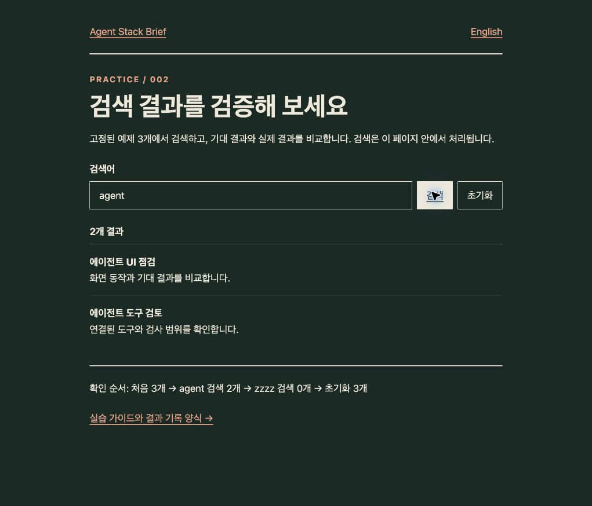

# Case 002 · Search passed. Can we trust the performance numbers too?

[Agent Stack Brief](../../README.en.md) · [한국어](002-browser-evidence.md) · **English** · [Try it yourself](../web-validation.en.md)

**Result:** all four search checks passed. The recording showed **visible movement with CLS 0, and an LCP image candidate absent from the example source**. Completion reports need measurement targets alongside scores.

**Executed · 2026-10-19:** browser automation performed the example flow while Chrome DevTools **Performance UI** recorded it. This was not execution through Chrome DevTools MCP.

## What did we check?

On the [deployed search example](https://yunsell.github.io/ai-agent-skills-korean/labs/search.html?lang=en), we checked the initial screen, searched `agent`, searched `zzzz`, and reset. The run used the Korean edition of this fixed newsletter example, not a production-service performance experiment.

| Condition | Record |
| --- | --- |
| Environment | macOS · Chrome 155.0.8059.82 · regular profile with extensions enabled |
| Viewport | 1021 × 874 CSS px · desktop mode |
| Capture | Performance Record · Screenshots enabled · reload followed by three search actions |
| Cache and throttling | Disable cache enabled · no CPU or network throttling |
| Execution time | 2026-10-19 10:49 KST · one run |
| Example version | [d70e87d](https://github.com/yunsell/ai-agent-skills-korean/blob/d70e87d4e7590273a8cd2f412b1114cef18dc11b/docs/labs/search.html) |

## Actual outcomes

| Step | Expected | Actual | Verdict |
| --- | --- | --- | --- |
| Initial screen | 3 results | 3 results | Pass |
| Search agent | 2 results | 2 results | Pass |
| Search zzzz | 0 results and helpful text | 0 results and helpful text | Pass |
| Reset | Empty input and 3 results | Empty input and 3 results | Pass |

[Watch the captured flow →](https://yunsell.github.io/ai-agent-skills-korean/evidence/002/search-filmstrip.mp4) · [Metric-event excerpt JSON](../../docs/evidence/002/metric-events.json)

The approximately 21.4-second video reconstructs **306 screenshot frames** from the Performance trace using their original intervals. It is a filmstrip preview, not MCP screencast output. The full recording also includes waiting, so video duration is not task speed.

<details>
<summary>Actual screen after searching agent</summary>



</details>

## Two findings more useful than the scores

**1. CLS 0 did not mean that nothing moved.**

DevTools displayed **CLS 0**. The trace nevertheless contained **three `LayoutShift` events**, all with `had_recent_input: true`, following search and reset. The instructions below the results moved as the list changed length. Expected shifts shortly after user input can be excluded from CLS. [How CLS works](https://web.dev/articles/cls)

**Takeaway:** inspect actual movement alongside the score when reviewing layout stability.

**2. We needed to check what the 0.33-second LCP represented.**

DevTools displayed **LCP 0.33s · INP 40ms · CLS 0**. The final extracted LCP candidate was an **`IMG` at 331.724ms** after navigation, but the example source and post-capture DOM contained no `img`. Transient elements introduced by the capture environment are one possible influence; the precise cause remains unresolved.

The largest EventTiming duration across the three click interactions was **39.733ms**. These observations describe this run, not real-user INP or overall service performance.

**Takeaway:** identify the LCP element before concluding that a page is fast, and repeat under other profiles and conditions. This case makes no performance-improvement claim.

## Retain evidence in the same way

1. Check behavior using the fixed inputs and expected outcomes in the [practice guide](../web-validation.en.md).
2. In Chrome DevTools → Performance, record cache, CPU, and network conditions. Enable Screenshots and press Record; reload, perform the searches, then Stop. [Recording reference](https://developer.chrome.com/docs/devtools/performance/reference)
3. Inspect metrics and elements for the new navigation, then save the trace. [Save instructions](https://developer.chrome.com/docs/devtools/performance/save-trace)

To extract the same kinds of events from your saved trace, run the command below with Node.js. The script reads a file and does not connect to a browser.

```bash
node scripts/extract-trace-evidence.mjs /path/to/Trace.json.gz
```

The excerpt contains selected navigation, LCP, interaction, and layout-shift events. It is not a complete trace that can be reimported into DevTools. The original archive, which includes extension code, is not published. Its SHA-256 is recorded in the excerpt.

Extraction is not anonymization. Use a single-page recording and review the JSON and every frame before sharing. Add `--video /path/to/output.mp4` to generate a filmstrip too; this optional feature requires FFmpeg.

**Established here:** four search checks and two cautions about interpreting the recording. **Not established:** execution of MCP screencast or Lighthouse tools, performance on other devices/networks, or before/after improvements attributable to a fix.

[Back to issue 002](../../newsletter/2026-10-19.en.md#mcp) · [Practice guide](../web-validation.en.md)
