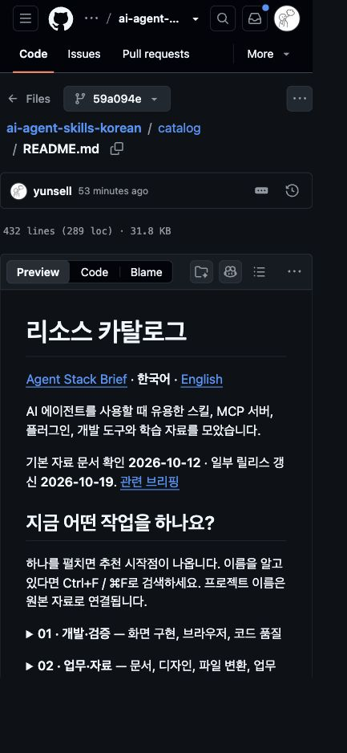
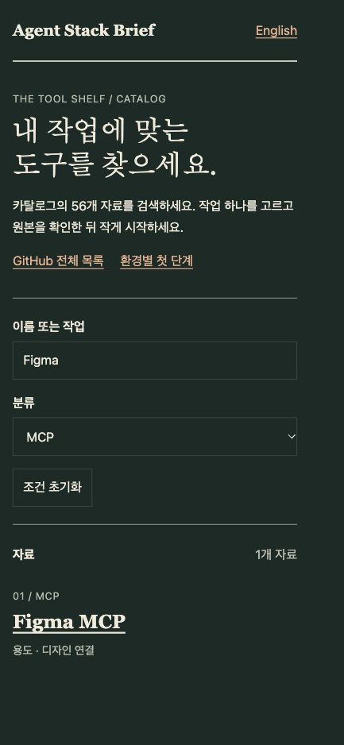

# 실제 디자인 업무 사례 · 이 카탈로그의 모바일 탐색 개선

[Agent Stack Brief](../../README.md) · **한국어** · [English](catalog-design.en.md) · [디자인 도구 선택](../design-workflows.md)

**결과부터:** 이 저장소의 실제 자료 56개를 보존하면서 GitHub의 4열 자료 표를 세로 목록으로 바꾸고, 한·영 검색 페이지를 만들었습니다. 별도 가상 쇼핑몰이나 목업이 아니라 지금 사용하는 카탈로그를 개선한 사례입니다.

[한국어 검색 페이지](https://yunsell.github.io/ai-agent-skills-korean/catalog/index.html) · [English reader](https://yunsell.github.io/ai-agent-skills-korean/catalog/en.html) · [GitHub 전체 목록](../../catalog/README.md)

## 작업과 선택

- **입력:** 기존 한·영 카탈로그의 9개 분류·56개 자료·원본 URL·용도·제공 기능·활용 예시. 기준 커밋은 `59a094e268ff618601a6cd6b8fee500a66ab610a`입니다.
- **문제:** 모바일에서 자료 이름·용도·기능·예시를 가로로 비교해야 했습니다. 390 CSS px에서 기존 GitHub Skills 표의 보이는 폭은 325px, 내용 폭은 496px였습니다.
- **설계:** GitHub에서는 모든 자료를 펼친 세로 목록으로 유지합니다. 별도 검색 페이지는 이름·작업 검색과 분류 선택을 결합하고, 원본 링크를 먼저 보여주며 기능·예시는 필요할 때 펼칩니다.
- **구현:** adapt·onboard·frontend-design 지침을 적용한 HTML/CSS/JavaScript와 브라우저 검증입니다. Figma·shadcn·Chrome MCP를 연결하거나 실행한 사례는 아닙니다. 설치가 없는 읽기 페이지이며 계정·분석 추적을 추가하지 않았습니다.

## 실제 화면

기존 GitHub 표와 새 검색 페이지는 **서로 다른 화면**입니다. 아래 이미지는 문제와 구현 결과의 근거이지, 동일 조건의 사용자 성과 실험이 아닙니다.





[데스크톱 전체 목록 화면](../../docs/evidence/catalog-design/reader-desktop.png) · [키보드 포커스 화면](../../docs/evidence/catalog-design/keyboard.png) · [불러오기 실패 화면](../../docs/evidence/catalog-design/error.png)

## 기대한 결과와 관찰한 결과

- **자료 보존:** 9개 분류·56개 자료가 양쪽 언어에 남아야 합니다. 이전 커밋과 이름·원본 URL·용도·기능·예시를 대조해 모두 보존된 것을 확인했습니다. 현재는 Markdown에서 검색 데이터를 생성하고 일치 여부를 검사합니다.
- **찾기:** `Figma` 검색 + `MCP` 분류 → 실제로 `Figma MCP` 1개가 나왔습니다. 결과 없음 안내와 초기화 후 56개 복귀도 확인했습니다.
- **이어가기:** 언어 전환·새로고침 후에도 URL의 검색어와 분류가 유지됐습니다. 영어 결과는 `1 resource`로 표시됐습니다.
- **키보드:** Tab으로 검색·분류·초기화·원본 링크·상세 항목에 이동하고 Space로 상세 항목을 열었습니다. 포커스 표시를 확인했습니다.
- **복구:** 로컬 미리보기에서 의도적으로 첫 데이터 요청에 HTTP 503을 반환했습니다. 오류·재시도·GitHub 목록 대안이 나타났고, 재시도 후 검색 조건을 유지한 채 1개 결과로 복구됐습니다. 운영 장애를 재현했다고 주장하지 않습니다.
- **화면 폭:** Chrome에서 320·390·768·1280 CSS px로 확인했습니다. 각 폭에서 전체 56개를 불러왔고 문서의 가로 스크롤 폭은 화면 폭과 같았습니다.

**기록:** [브라우저 관찰 13건](../../docs/evidence/catalog-design/checks.json) = 기능 경로 9건 + 화면 폭 4건. 2026-10-19 로컬 Chrome 검사이며 원시 trace가 아닌 수동 정리 기록입니다. 실제 휴대폰·보조공학·사용자 인터뷰·탐색 시간·전환율은 측정하지 않았습니다.

## 같은 작업을 재현하려면

저장소를 내려받은 뒤 Node.js 22 이상에서 실행합니다. 외부 패키지 설치나 MCP 등록은 필요 없습니다.

```bash
node scripts/build-catalog.mjs --check
node scripts/test-catalog.mjs
node scripts/preview-catalog.mjs
```

터미널에 표시되는 로컬 주소의 `/catalog/index.html`을 여세요. `Figma` + `MCP`, 결과 없음, 초기화, 언어 전환, 키보드 탐색을 확인합니다. 서버를 새로 시작한 뒤 `/fault/catalog/index.html?q=Figma&category=mcp`를 열면 첫 데이터 요청만 실패하므로 재시도를 확인할 수 있습니다. 이 경로는 로컬 검사 전용이며 Pages에는 배포하지 않습니다. 종료는 Ctrl+C입니다.

실제 디자인 원본이 필요하다면 다음 단계에서 [Figma 연결·컴포넌트 구현·브라우저 검증의 차이](../design-workflows.md)를 확인하세요. MCP 연결 자체가 처음이면 [사용 환경별 첫 단계](../client-first-steps.md)부터 시작합니다.
