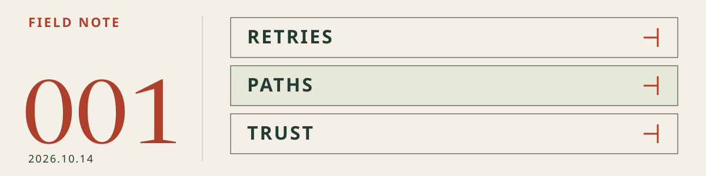

# 001 · Before adding tools, check the boundaries

[Agent Stack Brief](../README.en.md) · [한국어](2026-10-14.md) · **English** · [Archive](README.en.md)

**Published and reviewed: 2026-10-14 · Asia/Seoul** 
Topics: Skills · MCP·CLI · Harness 
Review level: **Primary documentation reviewed**. No installations, execution tests, or vulnerability reproductions.

<picture>
  <source media="(max-width: 600px) and (prefers-color-scheme: dark)" srcset="../assets/brief/issue-001-mobile-dark.svg">
  <source media="(max-width: 600px)" srcset="../assets/brief/issue-001-mobile-light.svg">
  <source media="(prefers-color-scheme: dark)" srcset="../assets/brief/issue-001-dark.svg">
  
</picture>

> Inaugural editor's note — review execution boundaries before adding tools. This edition combines today's fixes with important recent ones. Publication dates appear below; not every story was announced today.

## Three takeaways

- **MCP·CLI:** a missing response is not an execution failure. Inspect before retrying.
- **Harness:** check the resolved file target, not just the requested path.
- **Skills:** update scanners and pair their output with human review.

## 01 / MCP·CLI — retries need boundaries too

**Published:** 2026-10-14 Korea time · **For:** agent-browser CLI/MCP users · **Action:** review upgrade

**Fact:** agent-browser 0.39.1 fixes duplicate mutating/launch command execution after lost daemon responses. CLI JSON/MCP responses report `outcome_unknown` when a sent request's outcome is unclear. [Release](https://github.com/vercel-labs/agent-browser/releases/tag/v0.39.1)

**Why it matters — editorial:** silence does not justify repeating a write.

**Next action:** review upgrading and inspect current state before retrying an ambiguous operation. Separate read and write retry policies.

## 02 / Harness — check targets, not just path names

**Published:** 2026-10-14 Korea time · **For:** Deep Agents filesystem/approval users · **Action:** review upgrade

**Fact:** Deep Agents 0.7.25 checks both requested and symlink-resolved paths for permissions and approvals. Previously, following a link after validation could reach denied paths. [Release](https://github.com/langchain-ai/deepagents/releases/tag/deepagents%3D%3D0.7.25)

**Why it matters — editorial:** prompts do not replace filesystem access controls.

**Next action:** review the fix if affected, then test rules against link targets in isolation.

## 03 / Skills — scanners need review too

**Published:** 2.2.1 on 2026-10-06; 2.2.2 on 2026-10-09, Korea time · **For:** Skill Scanner users · **Action:** review upgrade

**Fact:** 2.2.1 fixes untrusted TAR/Markdown handling; 2.2.2 adds static detection and dependency fixes. [2.2.1](https://github.com/cisco-ai-defense/skill-scanner/releases/tag/2.2.1) · [2.2.2](https://github.com/cisco-ai-defense/skill-scanner/releases/tag/2.2.2)

**Why it matters — editorial:** scanner versions belong in your adoption review.

**Next action:** users of 2.2.0 should review patched releases. A passing scan is not a safety guarantee.

## One repository to explore / Deep Agents

**Use case:** evaluating a harness that bundles files, context, tools, and approvals. **Not a claim that the project is newly released.**

The [upstream README](https://github.com/langchain-ai/deepagents) describes bundled filesystem, subagents, context management, and skills. This can reduce assembly work, but tool permissions and sandbox boundaries still need separate design. A **documentation-based candidate**, not an adoption mandate or performance ranking.

Continue in the [Harnesses catalog](../catalog/README.en.md#harnesses).

## A small experiment / read-only investigation

Combination: **project skill + GitHub MCP read tools + your harness's approval rules**.

1. Use a public repository or isolated trial project. Do not connect write or deployment tools.
2. Ask for an issue investigation, related files, and a plan only.
3. Inspect actual exposed tools and permissions, not just the agent's explanation. Test denied operations separately where your environment supports it.

**Example first request**

> Read the issue and relevant files. Report evidence links, a root-cause hypothesis, and a change plan. Do not edit files, post comments, or deploy. If an outcome is unclear, report current state instead of retrying a write.

**Done when:** evidence, exposed tools and permission settings, approval boundaries, and execution/denial records if tested. This example is not itself a verified result. [GitHub MCP configuration source](https://github.com/github/github-mcp-server#read-only-mode)

## Continue reading and corrections

[First-stack guide](../guides/first-stack.en.md) · [Full catalog](../catalog/README.en.md) · [Editorial guidelines](../CONTRIBUTING.md#english)

Corrections will be recorded here with date and reason. Review dates change only for material actually rechecked. Submit stories or corrections through an [Issue](https://github.com/yunsell/ai-agent-skills-korean/issues).

**Corrections:** none — initial publication.
