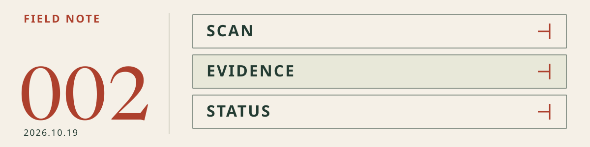

# 002 · Make agent work observable

[Agent Stack Brief](../README.en.md) · [한국어](2026-10-19.md) · **English** · [Archive](README.en.md)

**Published and reviewed: 2026-10-19 · Asia/Seoul** 
Topics: Skills · MCP · Harness 
Review level: **Docs reviewed**. No tool installation, execution, or vulnerability reproduction was performed.

<picture>
  <source media="(max-width: 600px) and (prefers-color-scheme: dark)" srcset="../assets/brief/issue-002-mobile-dark.svg">
  <source media="(max-width: 600px)" srcset="../assets/brief/issue-002-mobile-light.svg">
  <source media="(prefers-color-scheme: dark)" srcset="../assets/brief/issue-002-dark.svg">
  
</picture>

> Editor's note — tool counts are less useful than three questions: what was not scanned, where did time go, and is the task waiting for a person? These releases appeared after issue 001. Their announcement dates differ from today's review date.

## This issue in three lines

- **Skills:** check that scan results include targets that could not be inspected.
- **MCP:** attach recordings and performance diagnostics to completion reports.
- **Harness:** distinguish approval waits from failures in long-running work.

## 01 / Skills — scan gaps are results too

**Announced:** 2026-10-15, Korea time · **For:** Skill Scanner and skill-distribution CI users · **Decision:** review the update and CI rules

**Fact:** Skill Scanner 2.3.0 reports unfollowed symlinks as `SYMLINK_NOT_SCANNED` and unloadable skills in `scan-all` as `SKILL_LOAD_FAILED`. Taxonomy codes and YAML frontmatter scanning also change. [Primary release](https://github.com/cisco-ai-defense/skill-scanner/releases/tag/2.3.0)

**Why it matters — commentary:** fewer findings do not necessarily mean greater safety. Reduced coverage can look like an improvement.

**Next action:** compare versions against a fixed skill set and review unscanned or unloadable targets separately. Check how new findings and taxonomy changes affect existing SARIF filters and `--fail-on-severity` exit codes. Passing is not a safety guarantee.

## 02 / MCP — give “it works” supporting evidence

**Announced:** 2026-10-15, Korea time · **For:** developers validating websites with Chrome DevTools MCP · **Decision:** trial it in a diagnostic workflow

**Fact:** Chrome DevTools MCP 1.11.0 enables FFmpeg-free screencast tools by default and adds `ignoreCache` to `performance_start_trace`. `lighthouse_audit` includes failing audits and DOM nodes inline. [Primary release](https://github.com/ChromeDevTools/chrome-devtools-mcp/releases/tag/chrome-devtools-mcp-v1.11.0)

**Why it matters — commentary:** recordings and diagnostics make reviews more useful than an unsupported success statement. Cache conditions also affect performance comparisons.

**Next action:** use a test browser without sensitive accounts. Pick one flow and retain reproduction steps, a recording, and audit results. State cache conditions when comparing runs, and inspect recordings and network evidence for personal data or tokens. Recordings do not replace test assertions.

## 03 / Harness — distinguish stopped from waiting

**Announced:** 0.7.26 on 2026-10-16; 0.7.27 and 0.7.28 on 2026-10-17, Korea time · **For:** Deep Agents async-subagent and ContextHubBackend users · **Decision:** test observability and path handling

**Fact:** Deep Agents 0.7.26 adds human-wait reporting and parent-nested traces for async subagents; 0.7.27 adds status updates to the main agent. Version 0.7.28 fixes `ContextHubBackend.glob` to honor `path`. [0.7.26](https://github.com/langchain-ai/deepagents/releases/tag/deepagents%3D%3D0.7.26) · [0.7.27](https://github.com/langchain-ai/deepagents/releases/tag/deepagents%3D%3D0.7.27) · [0.7.28](https://github.com/langchain-ai/deepagents/releases/tag/deepagents%3D%3D0.7.28)

**Why it matters — commentary:** treating an approval wait as a timeout can lead to duplicate execution. Status distinctions support operational decisions, not just progress displays.

**Next action:** pin the SDK version and test separate records for approval waits, completion, and failure. If you use this backend, regression-test glob results under subdirectories too. Status notifications and path fixes do not replace permission enforcement.

## One project to inspect / Chrome DevTools MCP

**Use case:** explain why a page is slow or what failed after implementation. This is not a newly launched project.

Consider it for performance and network diagnosis rather than replacing every existing browser-interaction tool. Compare roles in the [MCP catalog](../catalog/README.en.md#mcp). This issue is neither a performance ranking nor an adoption guarantee.

## Small experiment / web validation with evidence

Combine **project acceptance criteria + Chrome DevTools MCP + approval boundaries**.

1. Choose one flow and expected outcome on a non-sensitive test page you control.
2. Use consistent reproduction steps and cache conditions; collect recordings, performance diagnostics, and failures.
3. Inspect evidence for sensitive data before sharing, and separate observations from unverified areas.

**First request example**

> Validate the flow from this test page's first screen to search results. Report reproduction steps, expected and actual outcomes, cache conditions, and recording/diagnostic evidence. Do not modify files, send data externally, or deploy. Stop and report if you encounter a login or sensitive data.

**Done means:** reproduction steps, expected and actual outcomes, versions and cache conditions, evidence file locations, and failed or unverified checks. This procedure is not an execution-test result.

## Further reading and corrections

[001 — execution boundaries](2026-10-14.en.md) · [First-stack guide](../guides/first-stack.en.md) · [Full catalog](../catalog/README.en.md) · [Editorial guidelines](../CONTRIBUTING.md#english)

Only reviewed areas receive new review dates. Send tips or corrections through an [Issue](https://github.com/yunsell/ai-agent-skills-korean/issues).

**Corrections:** none — initial publication.
