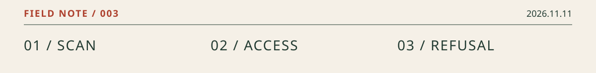

# 003 · What agents can read and why they stop

[Agent Stack Brief](../README.en.md) · [한국어](2026-11-11.md) · **English** · [Past issues](README.en.md)

**Published and reviewed: 2026-11-11 · Asia/Seoul** 
Skill scan comparisons · Fetch MCP host limits · Deep Agents model refusals 
**Review level:** Official releases and docs reviewed. We did not execute the tool changes in this issue. Announcement dates are GitHub publication timestamps converted to Korea time.

## Pick a story for your work

- **Scanning skills?** [Skill Scanner 2.3.2](#skills) — separate static findings from LLM verdict changes.
- **Fetching public docs?** [Fetch MCP 2026.11.4](#mcp) — allow only the hosts the task needs.
- **Running subagents?** [Deep Agents 0.7.33–0.7.35](#harness) — distinguish model refusals from execution failures.

## 01 / Skills — Find out why scan results changed

**Announced:** 2026-10-27 · **For:** Teams using Skill Scanner's optional LLM analyzer · **Decision:** Compare before and after by analysis type

**Fact:** 2.3.2 makes LLM inputs for the same skill consistent across presets. Static rules are unchanged, but some LLM finding titles or severities can differ from 2.3.1. Identical input does not guarantee identical model responses. [Original release](https://github.com/cisco-ai-defense/skill-scanner/releases/tag/2.3.2)

**Why it matters — editorial:** A severity change alone does not tell you whether the skill is safer. Separate changes to the skill, scanner, and model verdict.

**Try and verify:** Use one approved, non-sensitive skill bundle. Record the version, model, and preset; compare static findings, LLM verdicts, and CI outcomes separately. Review which files would leave your environment before using an external LLM. [Scan coverage checks in the previous issue](2026-10-19.en.md#skills)

## 02 / MCP — Read-only still means making a connection

**Announced:** 2026-11-05 · **For:** Operators using Fetch MCP to retrieve public docs · **Decision:** Trial it on tasks with known destinations

**Fact:** MCP Reference Servers v2.3.0 includes Python package `mcp-server-fetch` **2026.11.4**, which adds the opt-in `--allowed-hosts` option. When configured, the allowlist also applies to `robots.txt` requests and each redirect hop. The repository and package have separate version numbers. [Release](https://github.com/modelcontextprotocol/servers/releases/tag/v2.3.0) · [Versioned package docs](https://pypi.org/project/mcp-server-fetch/2026.11.4/) · [Implementation and test notes](https://github.com/modelcontextprotocol/servers/pull/5392)

**Why it matters — editorial:** If a task only reads a few public documentation sites, an allowlist can reduce unnecessary outbound requests. It does not restrict other tools or processes, and content from allowed sites is still untrusted input.

**Try and verify:** Run the allow/deny exercise below. In production, keep the default private-address guard and do not treat the option as a substitute for network isolation. If you have no MCP connection yet, [client first steps](../guides/client-first-steps.en.md) explains how to tell registration from a successful call.

## 03 / Harness — Don't record a model refusal as completion

**Announced:** 0.7.33 on 2026-11-06; 0.7.35 on 2026-11-10 · **For:** Teams handling subagent results with the Deep Agents SDK · **Decision:** Regression-test error branches and displayed states

**Fact:** SDK 0.7.33 raises model refusals as errors by default and reports subagent refusals to the parent. 0.7.35 aligns forked subagents' prompt-cache prefixes with the parent and preserves symlink names in virtual filesystem results. These are SDK versions, not CLI versions. [SDK changelog](https://github.com/langchain-ai/deepagents/blob/main/libs/deepagents/CHANGELOG.md) · [0.7.33 release](https://github.com/langchain-ai/deepagents/releases/tag/deepagents%3D%3D0.7.33) · [0.7.35 release](https://github.com/langchain-ai/deepagents/releases/tag/deepagents%3D%3D0.7.35)

**Why it matters — editorial:** An empty success can trigger the wrong next step. Retrying a refusal as though it were a transient outage can repeat the same request.

**Try and verify:** In a test environment, simulate success, a model refusal, and a timeout. Check the parent task's state and whether follow-on work runs. Verify that a refusal is neither recorded as success nor automatically retried. [Approval-wait checks in the previous issue](2026-10-19.en.md#harness)

## Small exercise / Verify that Fetch only reads allowed hosts

If you already run a test Fetch MCP server, pin 2026.11.4 and add `--allowed-hosts example.com` to its arguments. Use a non-sensitive test environment, not your production server.

| Input | Expected outcome |
| --- | --- |
| `https://example.com/` | With working networking, the Fetch tool returns the public content |
| `https://www.iana.org/help/example-domains` | The Fetch tool rejects the unlisted host |

**Record:** `package version / input URL / expected result / actual tool result / pass or fail`. Inspect the actual tool result, not the model's recap. Do not retry the second request through another web tool. These are expected outcomes, not results we ran for this issue.

View the 003 cover

<picture>
  <source media="(max-width: 600px) and (prefers-color-scheme: dark)" srcset="../assets/brief/issue-003-mobile-dark.svg">
  <source media="(max-width: 600px)" srcset="../assets/brief/issue-003-mobile-light.svg">
  <source media="(prefers-color-scheme: dark)" srcset="../assets/brief/issue-003-dark.svg">
  
</picture>

## Read next and send corrections

[Issue 002 — Make agent work observable](2026-10-19.en.md) · [Full catalog](../catalog/README.en.md) · [Editorial guidelines](../CONTRIBUTING.md#english)

Share missing stories and corrections via [Issues](https://github.com/yunsell/ai-agent-skills-korean/issues).
