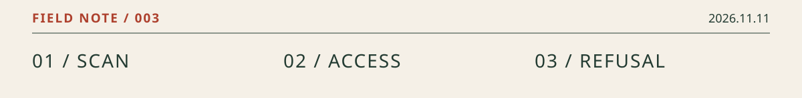

# 003 · 에이전트가 읽는 범위와 멈추는 이유

[Agent Stack Brief](../README.md) · **한국어** · [English](2026-11-11.en.md) · [지난호](README.md)

**발행·확인: 2026-11-11 · Asia/Seoul** 
스킬 검사 결과 비교 · Fetch MCP 호스트 제한 · Deep Agents 모델 거부 처리 
**확인 수준:** 공식 릴리스와 문서 확인. 이번 호의 도구 동작은 직접 실행하지 않았습니다. 발표일은 GitHub 릴리스 공개 시각을 한국 시간으로 환산했습니다.

## 내 작업에 맞는 소식

- **스킬을 검사한다면:** [Skill Scanner 2.3.2](#skills) — 정적 탐지와 LLM 판정 변화 분리하기.
- **공개 문서를 자동으로 읽는다면:** [Fetch MCP 2026.11.4](#mcp) — 필요한 호스트만 허용하기.
- **서브에이전트를 운영한다면:** [Deep Agents 0.7.33–0.7.35](#harness) — 모델 거부와 실행 실패 구분하기.

## 01 / Skills — 검사 결과가 바뀐 이유부터 확인하세요

**발표:** 2026-10-27 · **대상:** Skill Scanner의 선택적 LLM 분석을 쓰는 팀 · **판단:** 업데이트 전후 결과를 분리 비교

**사실:** 2.3.2는 같은 스킬에 대한 LLM 입력을 프리셋 간 일관되게 구성합니다. 정적 탐지 규칙은 그대로지만 2.3.1 대비 일부 LLM 판정 제목·심각도가 달라질 수 있습니다. 입력이 같아도 모델 응답의 반복 재현을 보장하지는 않습니다. [원본 릴리스](https://github.com/cisco-ai-defense/skill-scanner/releases/tag/2.3.2)

**의미 — 편집 의견:** 심각도 변화만으로 스킬이 안전해졌다고 판단할 수 없습니다. 바뀐 것이 스킬인지, 검사 버전인지, 모델 판정인지 구분해야 합니다.

**적용·확인:** 승인된 비민감 스킬 묶음 하나로 버전·모델·프리셋을 기록하고, 정적 탐지·LLM 판정·CI 통과 여부를 따로 비교하세요. 외부 LLM을 쓰기 전에 전송할 파일의 범위를 확인합니다. [이전 호의 검사 누락 점검](2026-10-19.md#skills)

## 02 / MCP — 읽기 전용이어도 어디에 연결할지 정하세요

**발표:** 2026-11-05 · **대상:** 공개 문서 수집용 Fetch MCP 운영자 · **판단:** 외부 연결 대상이 정해진 작업에서 시험

**사실:** MCP Reference Servers v2.3.0에 포함된 Python 패키지 `mcp-server-fetch` **2026.11.4**는 선택 옵션 `--allowed-hosts`를 추가했습니다. 설정하면 요청 대상뿐 아니라 `robots.txt` 조회와 리디렉션의 각 단계도 허용 목록을 적용합니다. 저장소와 패키지 버전은 서로 다릅니다. [릴리스](https://github.com/modelcontextprotocol/servers/releases/tag/v2.3.0) · [버전 고정 패키지 문서](https://pypi.org/project/mcp-server-fetch/2026.11.4/) · [구현·검증 기록](https://github.com/modelcontextprotocol/servers/pull/5392)

**의미 — 편집 의견:** 공개 문서 몇 곳만 읽는 작업이라면, 허용 목록으로 불필요한 외부 요청을 줄일 수 있습니다. 이 옵션은 다른 도구나 프로세스의 네트워크 접근을 제한하지 않으며, 허용 사이트의 본문도 신뢰할 수 없는 입력입니다.

**적용·확인:** 아래 실습으로 허용·거부 두 결과를 확인하세요. 운영에서는 이 옵션만으로 네트워크 격리를 대신하지 말고, 기본 사설 IP 차단을 유지하세요. 이미 연결된 MCP가 없는 경우 [환경별 첫 단계](../guides/client-first-steps.md)에서 연결과 실제 호출 성공의 차이를 먼저 확인하세요.

## 03 / Harness — 모델 거부를 ‘완료’로 기록하지 마세요

**발표:** 0.7.33은 2026-11-06, 0.7.35는 2026-11-10 · **대상:** Deep Agents SDK에서 서브에이전트 결과를 처리하는 팀 · **판단:** 오류 분기와 화면 상태를 회귀 검사

**사실:** SDK 0.7.33은 모델 거부를 기본적으로 오류로 올리고 서브에이전트의 거부를 부모 에이전트에 보고합니다. 0.7.35는 분기된 서브에이전트의 프롬프트 캐시 접두사를 부모와 일치시키고, 가상 파일시스템 결과에서 심볼릭 링크 이름을 보존합니다. 이는 CLI 버전이 아닙니다. [SDK 변경 기록](https://github.com/langchain-ai/deepagents/blob/main/libs/deepagents/CHANGELOG.md) · [0.7.33 릴리스](https://github.com/langchain-ai/deepagents/releases/tag/deepagents%3D%3D0.7.33) · [0.7.35 릴리스](https://github.com/langchain-ai/deepagents/releases/tag/deepagents%3D%3D0.7.35)

**의미 — 편집 의견:** 거부를 빈 성공으로 취급하면 다음 단계가 잘못 실행되고, 일반 장애처럼 무조건 재시도하면 같은 요청이 반복됩니다.

**적용·확인:** 테스트 환경에서 정상 응답·모델 거부·시간 초과를 각각 모의 입력으로 만들고, 부모 작업의 상태와 후속 실행 여부를 확인하세요. 거부가 성공으로 기록되거나 자동 재시도로 이어지지 않는지 보세요. [이전 호의 승인 대기 점검](2026-10-19.md#harness)

## 작은 실습 / 허용한 호스트만 읽는지 확인

이미 테스트용 Fetch MCP를 운영 중이라면 2026.11.4를 고정하고 서버 인수에 `--allowed-hosts example.com`을 추가합니다. 운영 서버 대신 비민감 시험 환경을 사용하세요.

| 입력 | 기대 결과 |
| --- | --- |
| `https://example.com/` | 네트워크가 정상이라면 Fetch 도구가 공개 본문을 반환 |
| `https://www.iana.org/help/example-domains` | Fetch 도구가 허용되지 않은 호스트로 거부 |

**기록 양식:** `패키지 버전 / 입력 URL / 기대 결과 / 실제 도구 결과 / 통과·실패`. 모델의 요약이 아니라 실제 도구 응답을 확인하세요. 두 번째 요청을 다른 웹 도구로 재시도하지 않습니다. 위 표는 기대값이며 이번 호의 실행 결과가 아닙니다.

003호 표지 보기

<picture>
  <source media="(max-width: 600px) and (prefers-color-scheme: dark)" srcset="../assets/brief/issue-003-mobile-dark.svg">
  <source media="(max-width: 600px)" srcset="../assets/brief/issue-003-mobile-light.svg">
  <source media="(prefers-color-scheme: dark)" srcset="../assets/brief/issue-003-dark.svg">
  
</picture>

## 이어 읽기와 정정

[002호 — 더 많은 도구보다, 더 잘 보이는 실행](2026-10-19.md) · [전체 카탈로그](../catalog/README.md) · [편집 기준](../CONTRIBUTING.md#korean)

빠진 소식과 정정은 [Issue](https://github.com/yunsell/ai-agent-skills-korean/issues)로 알려 주세요.
