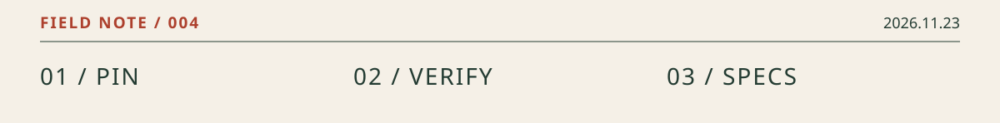

# 004 · Restore the same skills and review change specs

[Agent Stack Brief](../README.en.md) · [한국어](2026-11-23.md) · **English** · [Past issues](README.en.md)

**Published and reviewed 2026-11-23 · Asia/Seoul** 
Skills CLI commit pinning · MCP Skills extension beta · OpenSpec offline skill installs 
We reviewed official releases and versioned docs. The exercise gives expected outcomes. Release dates use Korea time.

- To restore the same skills as your team, read [installed commit pinning](#skills).
- To serve skills remotely, read [file verification in the MCP Skills beta](#mcp).
- To review scope before implementation, read [OpenSpec 2.1.1](#harness).

**Security advisory · Microsoft Agent Framework.** The GitHub Advisory Database lists PyPI `agent-framework` versions 1.26.1 and 1.26.2 as malicious. Both versions have been removed from PyPI. If either was installed, isolate the affected environment and rotate credentials it could access. [GitHub security advisory](https://github.com/advisories/GHSA-764m-3ppc-5m73)

## 01 / Skills — Record the commit your team installed

**Released November 16 · For developers who manage team skills with Skills CLI**

Skills CLI 1.9.0 can record the installed Git commit in the project lockfile. For entries with a `commit` value, `skills install` restores from that commit. Older entries without the field still follow their existing `ref`, so check whether your team's lockfile has the commit. [1.9.0 release](https://github.com/vercel-labs/skills/releases/tag/v1.9.0) · [Commit tracking and restore change](https://github.com/vercel-labs/skills/pull/2735)

If CI uses `experimental_sync`, check that path as well. An issue open as of November 23 reports that frozen sync in 1.9.0 can fail after it reads the branch tip for a remote skill with a pinned commit. [Public issue #2774](https://github.com/vercel-labs/skills/issues/2774)

## 02 / MCP — Verify file hashes when reading remote skills

**Released November 20 · For MCP server and client developers**

MCP Skills extension v0.1.0 is the first beta tag and targets base protocol revision `2026-07-28`. A supporting server exposes skill entries and per-file hashes. The client checks files it reads through Resources against those hashes. The release provides JSON Schema and TypeScript types. [Beta release](https://github.com/modelcontextprotocol/ext-skills/releases/tag/v0.1.0) · [v0.1.0 specification](https://github.com/modelcontextprotocol/ext-skills/blob/v0.1.0/specification/beta/skills.mdx)

Check extension support in your target host before prototyping. If the host persists a user's approval, it must bind it to the file list and hashes at approval time and ask again if a file is added, removed, or changed. [Official overview and support links](https://modelcontextprotocol.io/extensions/skills/overview) · [v0.1.0 specification](https://github.com/modelcontextprotocol/ext-skills/blob/v0.1.0/specification/beta/skills.mdx)

## 03 / Workflow — Review the change spec before implementation

**Released November 20 · For teams delegating changes to coding agents**

OpenSpec is a CLI for keeping change proposals, specs, and tasks in a project. In 2.1.1, `init` and `update` install skills bundled with the CLI, so that step works without GitHub access once the CLI is installed. If the archive folder already exists, archive now stops before editing the main specs. [2.1.1 release](https://github.com/Fission-AI/OpenSpec/releases/tag/v2.1.1)

Start with one small change, such as showing reset instructions when a search yields no results. Propose it and review the scope and acceptance criteria before implementation. This gives the reviewer and the agent the same definition of done for a single-screen change. [Versioned getting-started guide](https://github.com/Fission-AI/OpenSpec/blob/v2.1.1/README.md)

## Small exercise / Restore a skill in a clean checkout

Use a test repo with Skills CLI 1.9.0 and one approved public Git skill. Run these checks in a fresh checkout. The second step restores skills into that checkout. [1.9.0 CLI reference](https://github.com/vercel-labs/skills/blob/v1.9.0/docs/commands.md)

1. Check that the entry in `skills-lock.json` contains a `commit` value.
2. Run `npx skills@1.9.0 install --frozen-lockfile` and check the exit code and restored `SKILL.md`.
3. Run `git diff --exit-code -- skills-lock.json` to verify that the lockfile stayed the same.

**Expected result** · The skill is restored and both commands exit with code 0.
**Record** · CLI version / skill name / commit / restore exit code / whether the lockfile changed

View the issue 004 cover

<picture>
  <source media="(max-width: 600px) and (prefers-color-scheme: dark)" srcset="../assets/brief/issue-004-mobile-dark.svg">
  <source media="(max-width: 600px)" srcset="../assets/brief/issue-004-mobile-light.svg">
  <source media="(prefers-color-scheme: dark)" srcset="../assets/brief/issue-004-dark.svg">
  
</picture>

[Issue 003](2026-11-11.en.md) · [Full catalog](../catalog/README.en.md) · [Editorial guidelines](../CONTRIBUTING.md#english) · [Tips and corrections](https://github.com/yunsell/ai-agent-skills-korean/issues)
