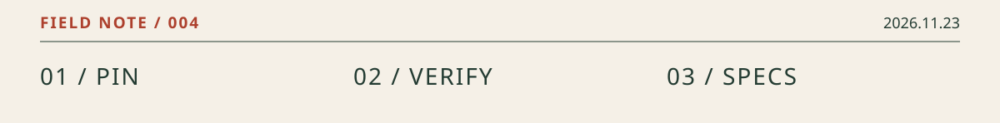

# 004 · 같은 스킬을 복원하고 변경 명세를 검토하는 법

[Agent Stack Brief](../README.md) · **한국어** · [English](2026-11-23.en.md) · [지난호](README.md)

**발행·확인 2026-11-23 · Asia/Seoul** 
Skills CLI 커밋 고정 · MCP Skills 확장 베타 · OpenSpec 오프라인 스킬 설치 
공식 릴리스와 버전별 문서를 확인했습니다. 아래 실습은 기대 결과를 제시합니다. 릴리스 공개일은 한국 시간 기준입니다.

- 팀과 같은 스킬을 복원하려면 [설치 커밋 고정](#skills)
- 서버에서 스킬을 제공하려면 [MCP Skills 베타의 파일 검증](#mcp)
- 구현 전에 변경 범위를 검토하려면 [OpenSpec 2.1.1](#harness)

**보안 공지 · Microsoft Agent Framework.** GitHub Advisory Database는 PyPI의 `agent-framework` 1.26.1과 1.26.2를 악성 배포본으로 분류했습니다. 두 버전은 PyPI에서 제거됐습니다. 설치한 환경이 있다면 격리하고 접근 가능했던 자격 증명을 교체하세요. [GitHub 보안 공지](https://github.com/advisories/GHSA-764m-3ppc-5m73)

## 01 / Skills — 팀이 설치한 커밋을 기록하세요

**11월 16일 공개 · Skills CLI로 팀 스킬을 관리하는 개발자**

Skills CLI 1.9.0은 Git 소스에서 설치한 커밋을 프로젝트 락 파일에 기록할 수 있습니다. `skills install`은 `commit` 값이 있는 항목을 해당 커밋에서 복원합니다. 예전 항목에 이 값이 없으면 기존 `ref`를 따르므로, 팀 저장소에서 실제로 기록됐는지 확인하세요. [1.9.0 릴리스](https://github.com/vercel-labs/skills/releases/tag/v1.9.0) · [커밋 기록과 복원 변경](https://github.com/vercel-labs/skills/pull/2735)

CI에서 `experimental_sync`를 쓴다면 그 경로도 따로 점검하세요. 1.9.0에서 락 파일의 커밋 대신 브랜치 최신본을 읽어 frozen 동기화가 실패했다는 이슈가 11월 23일 기준 열려 있습니다. [공개 이슈 #2774](https://github.com/vercel-labs/skills/issues/2774)

## 02 / MCP — 원격 스킬을 읽을 때 파일 해시를 대조하세요

**11월 20일 공개 · MCP 서버와 클라이언트 개발자**

MCP Skills 확장 v0.1.0은 기본 프로토콜 `2026-07-28`을 대상으로 공개된 첫 베타 태그입니다. 지원 서버는 스킬 목록과 파일별 해시를 제공하고 클라이언트는 Resources로 읽은 파일을 해당 해시와 대조합니다. 릴리스에는 JSON Schema와 TypeScript 타입이 포함됩니다. [베타 릴리스](https://github.com/modelcontextprotocol/ext-skills/releases/tag/v0.1.0) · [v0.1.0 규격](https://github.com/modelcontextprotocol/ext-skills/blob/v0.1.0/specification/beta/skills.mdx)

프로토타입에서는 사용할 호스트의 확장 지원부터 확인하세요. 사용자 승인을 저장하는 호스트는 승인 당시의 파일 목록과 해시를 기록하고, 파일이 추가·삭제·변경되면 다시 승인을 요청해야 합니다. [공식 개요와 지원 현황](https://modelcontextprotocol.io/extensions/skills/overview) · [v0.1.0 규격](https://github.com/modelcontextprotocol/ext-skills/blob/v0.1.0/specification/beta/skills.mdx)

## 03 / 워크플로 — 구현 전에 변경 명세를 검토하세요

**11월 20일 공개 · 코딩 에이전트에 변경을 맡기는 팀**

OpenSpec은 변경 제안, 명세, 작업 목록을 프로젝트 안에서 관리하는 CLI입니다. 2.1.1부터 `init`과 `update`는 이미 설치된 CLI에 포함된 스킬을 사용해, 스킬 설치 단계에서 GitHub 접속이 필요 없습니다. 아카이브 대상 폴더가 이미 있다면 메인 명세를 수정하기 전에 중단합니다. [2.1.1 릴리스](https://github.com/Fission-AI/OpenSpec/releases/tag/v2.1.1)

작은 변경 하나로 시작하세요. 예를 들어 ‘검색 결과가 없을 때 초기화 안내 표시’를 제안하고, 구현 전에 변경 범위와 완료 조건을 검토합니다. 단일 화면 변경을 맡길 때도 무엇을 확인해야 완료인지 팀에서 공유할 수 있습니다. [버전별 시작 안내](https://github.com/Fission-AI/OpenSpec/blob/v2.1.1/README.md)

## 작은 실습 / 깨끗한 체크아웃에서 스킬 복원하기

Skills CLI 1.9.0과 팀에서 승인한 공개 Git 스킬 하나를 사용하는 시험 저장소를 준비하세요. 새 체크아웃에서 아래 순서로 확인합니다. 두 번째 단계는 시험 체크아웃에 스킬을 복원합니다. [1.9.0 CLI 명령 문서](https://github.com/vercel-labs/skills/blob/v1.9.0/docs/commands.md)

1. `skills-lock.json`의 해당 항목에 `commit` 값이 있는지 확인합니다.
2. `npx skills@1.9.0 install --frozen-lockfile`을 실행하고 종료 코드와 복원된 `SKILL.md`를 확인합니다.
3. `git diff --exit-code -- skills-lock.json`으로 락 파일이 그대로인지 확인합니다.

**기대 결과** · 지정한 스킬이 복원되고 두 명령이 모두 종료 코드 0을 반환합니다.
**기록** · CLI 버전 / 스킬 이름 / 커밋 / 복원 종료 코드 / 락 파일 변경 여부

004호 표지 보기

<picture>
  <source media="(max-width: 600px) and (prefers-color-scheme: dark)" srcset="../assets/brief/issue-004-mobile-dark.svg">
  <source media="(max-width: 600px)" srcset="../assets/brief/issue-004-mobile-light.svg">
  <source media="(prefers-color-scheme: dark)" srcset="../assets/brief/issue-004-dark.svg">
  
</picture>

[003호](2026-11-11.md) · [전체 카탈로그](../catalog/README.md) · [편집 기준](../CONTRIBUTING.md#korean) · [제보·정정](https://github.com/yunsell/ai-agent-skills-korean/issues)
